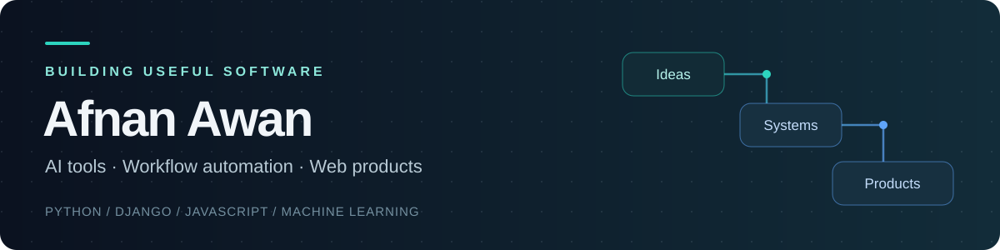

I build AI-assisted tools, browser automation, and web applications. My work connects **Python and Django backends**, **practical interfaces**, and **machine-learning workflows**—from local speech assistants to job-search systems and spatial training simulations.

[Explore my repositories](https://github.com/awanafnan17?tab=repositories) · [HAC Studios live](https://www.thehacstudios.com/) · [OpenCluely setup](https://github.com/awanafnan17/OpenCluely#readme) · [HuntFlow guide](https://github.com/awanafnan17/huntflow/blob/main/docs/USAGE.md)

## Selected work

| Project | What it does | Built with |
|---|---|---|
| **[OpenCluely](https://github.com/awanafnan17/OpenCluely)** | Desktop conversation copilot with Markdown briefs, local speech transcription and streamed answers. **Development source release.** | Electron · JavaScript · Python · Whisper · Ollama |
| **[HuntFlow](https://github.com/awanafnan17/huntflow)** | AI-assisted LinkedIn messaging, outreach CRM, candidate documents and supported Easy Apply workflows. Extends OpenOutreach with a dashboard, career tools and approval controls. **Still in development.** | Django · Playwright · PostgreSQL · PydanticAI · Ollama |
| **[HAC Studios](https://github.com/awanafnan17/TheHACStudios)** | Wedding photography and cinematography portfolio with an editorial static build and custom WordPress child theme. **[Live website ↗](https://www.thehacstudios.com/)** · The live WordPress site differs from the earlier static preview. | Python · HTML/CSS · JavaScript · WordPress/PHP |
| **[FieldFix AR](https://github.com/awanafnan17/FieldFix-AR)** | Hands-free industrial maintenance **training simulation** for Snap SPECS: trace a fault, inspect 3D components and follow a guided repair sequence. | Lens Studio · TypeScript · SIK · UIKit · LEAF |
| **[BOOM Challenge](https://github.com/awanafnan17/boom-challenge-submission)** | Physics-informed ensemble modeling for asteroid-impact ejecta prediction and inverse design. A competition submission with reproducible methods documented in the repository. | Python · PyTorch · XGBoost · LightGBM · scikit-learn |

## What I work on

- **AI applications:** local model integration, speech transcription, structured generation and evidence-based document workflows.
- **Automation systems:** browser-driven tasks, persistent queues, review gates, state tracking and outcome verification.
- **Web products:** Django applications, dashboards, business websites and usable frontends.
- **Applied experiments:** machine learning, scientific optimization, geospatial work and interactive AR.

## Tools across my projects

## Explore further

[Ride-sharing app](https://github.com/awanafnan17/Ride-Sharing-App) · [Geospatial analysis](https://github.com/awanafnan17/geospatial-data-analysis-python) · [Student performance analytics](https://github.com/awanafnan17/student-performance-analytics-algorithm)

Each featured repository explains its setup, implementation and current limitations. Open-source foundations and contributors are credited in the project documentation.
